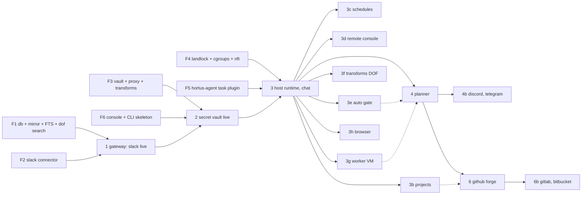

# Build order review (v6 → as built)

Review of the Build order table in `hortus_v6.md` against the rest of the spec, and the order this repository is built in. Each step still "leaves something running"; the change is that the shared primitives are pulled out as parallel foundation tracks, and the integration steps consume them.

## Gaps in the v6 table

Items the spec describes but no step claims, now assigned (also added to the v6 table):

| Missing | Spec section | Assigned to |
| --- | --- | --- |
| `trusted` flag on events, 10-min history reconcile, backfill cursors | Gateway, Mirror | 1 |
| Response scrubbing (`text/event-stream` carry), SSE and `application/x-git-*` streaming through the proxy, `origins` egress check (`"*"` never private) | Secret Vault, Config | 2 |
| `openai` transform (and `ollama`, `openrouter`: the LLM in use here is OpenAI-compatible) | Shipped transforms | 2 |
| Slack transform `refs` (a posted thread routes follow-ups) | Mount | 2 |
| Console request guards (`Host`, `Sec-Fetch-Site`, `X-Hortus`) | Console › Decisions | 2 |
| Landlock, both profiles (was 3b; a chat session without it reads `vault.json`) | Security › Host | 3 |
| Recovery on start (orphaned `running` tasks, synthetic interrupted results) | Process › Recovery | 3 (extended by 3c, 3g, 3h) |
| Budget (`tokens`, `hours`, `budget_exceeded`), context handoff at 70% (`PROGRESS.md`), task close cleanup (`tasks/<id>`, `clones/<task>`), `chat.allow` | Worker, Chat, Network | 3 |
| Loop guard (bot events never wake), `daily_tokens`, `PAUSED` skipping batches | Planner › Guards | 4 |
| `aws-sigv4` built-in operation | Secret Vault › Built-in operations | 3f (with the transforms DOF) |
| Planner runtime before VMs exist (step 4 precedes step 5) | Planner › Run | 4: `planner.runtime` (v7) |
| VM kill on `hours`, `console.log`, initramfs for the stock kernel | Security › VM | 3g |
| Login view recovery (Chromium restarted when opened) | Recovery, Browser | 3h |

Inconsistencies fixed by the order below:

- Step 2's done-when needs a request "from a session address", but session addresses and the cgroup rules are step 3. Fixed: the client registry (address → role, task) is built in 2 and tested with an address added by hand; 3 adds the cgroup rules.
- Step 3b held Landlock while step 3 already ran chat sessions on the host with the owner's files. Fixed: Landlock is a foundation track (F4) and is wired in 3.
- Step 7 (`auto` gate) sat after the forges, so every reply in the step-4 flow needed a click. Nothing in 4–6 depends on its absence; it moves to the wave after 3.
- Step 4's Planner "runs in a fresh VM per batch", but VMs are step 5. Fixed: `planner.runtime` (v7), `host` until 3g lands.

## Parallelism

The spec's steps are integration milestones; most of the code under them has no dependency on each other. Three waves:

Solid arrows are hard dependencies; dotted ones improve the done-when (no click per reply, Planner in a VM, local-origin merges next to forge PRs).

## The order as built

| Step | Builds | Done when | Runs in parallel with | Status |
| --- | --- | --- | --- | --- |
| F0 | Repository: package, `tsconfig`, `biome`, `@hortus/core@^1.2.0`, `node:sqlite`, config schema (`hortusd.json`), `HORTUS_HOME`, ids, logging, the RPC router skeleton (one handler table, three transports) | `pnpm build && pnpm test` passes on an empty daemon that opens its DB and answers `ping` on the abstract socket | nothing: everything imports it | done; round 5: start-up errors exit 78 with one line (`RestartPreventExitStatus=78`) |
| F1 | DB schema, mirror writer (Change[] → Markdown files → one commit per sync), FTS5 index from the commit diff, `dof search` (RPC + CLI), the `logs` renderer | synthetic Changes land as files on `main`; `dof search` finds them with filters; a 2-char query falls back to `LIKE` | F2–F6 | done |
| F2 | `slack` connector against a fake Slack (Socket Mode + Web API): `events`, `key`, `mirror`, `author`, `history`, `dm` | every event kind maps to Changes; a replayed envelope keys the same; `history` resumes from its cursor | F1, F3–F6 | done (fake Slack) |
| F3 | CA, per-host certs, dummy interface and taps, DNS, SNI/Host proxy, client registry, QuickJS transform runtime, manifests, placeholder resolution, location/destination/consequential/scope enforcement, scrubbing, SSE and git streaming, egress `origins`, approvals table and gate under `human`, in-process role `core` client; `slack`, `anthropic`, `openai`, `ollama`, `openrouter` transforms | a client with a placeholder reaches a fake upstream with the real token; a real token at a declared location is refused; a placeholder outside a declared location is refused; `403 {approval}` then a retry passes; SSE streams unbuffered with secrets scrubbed | F1, F2, F4–F6 | done (fake upstreams); round 5: per-client in-flight and buffering bounds, upstream idle timeout, ws backpressure (`src/e2e/dos.test.ts`); the private-address check covers listed hosts; round 6: round-robin request/RPC starts across clients, a global buffering bound (20 Workers flooding: console p95 ≈ 30 ms) |
| F4 | `hortus-landlock` C shim (cgroup attach → Landlock → exec), profile builder (unattended, chat), cgroup create/kill, session addresses, nftables per cgroup, CA env for host children | a child under the unattended profile cannot open `vault.json` or connect to port 7700 or the abstract socket, can write its clone, and dies with `cgroup.kill` | F1–F3, F5, F6 | done; nftables/session-address tests opt-in (`HORTUS_TEST_NET=1`) |
| F5 | `hortus-agent` task plugin: `ctl/`/`out/`, inbox drain and wrapping, steering abort, `STOP`, budget, resume from JSONL, `send`/`done`, summary, context handoff, stdout stream | against a directory and DeepSeek: a message in `inbox/` lands after the next tool result; kill −9 mid-run then restart resumes; `summary.md` appears on `done` | F1–F4, F6 | done; the live-model check opt-in (`HORTUS_TEST_LLM=1`) |
| F6 | Console HTTP server (loopback), request guards, SSE, page shell, abstract-socket RPC, `hortus` CLI skeleton | a request without `X-Hortus` or with a foreign `Host` is refused; `hortus ping` answers over the socket | F1–F5 | done; round 6: long lists paged in SQL (50 a page, "showing … of …"), `approval.count` for the nav badge, `hortus tasks`/`approvals --all` |
| 1 | F0+F1+F2 wired: system unit, `hortus install`, Slack live with `vault.json` read directly, dedupe, `trusted`, backfill, 10-min reconcile | a Slack message is a file on `main` within seconds; `dof search` finds it | — | done against the fake Slack; real Slack pending credentials; round 5: mirror commit survives ENOSPC (`src/mirror/enospc.test.ts`); `dof.search` snippet linear |
| 2 | F3+F6 wired: the connector syncs as role `core` with a placeholder; Approvals and Credentials pages | as v6 step 2 | — | done against fakes |
| 3 | F4+F5 wired: dispatcher, host sessions (chat, unattended), `logs` DOF, recovery, budgets, close cleanup, `chat.allow`; Tasks, Chat, Projects (config only), Settings, Search pages; `hortus chat`, `hortus tasks`, `hortus approvals` | as v6 step 3, plus "a chat session cannot open `vault.json`" | — | done (`src/e2e/step3.test.ts`, NO_NET); network rules only under `HORTUS_TEST_NET=1`, live model under `HORTUS_TEST_LLM=1` |
| 3b | Projects: origin, `pre-receive`, sync, `merge()`, shadow repos, Projects page actions | as v6 step 3b (minus Landlock) | 3c–3h | done (`src/e2e/projects.test.ts`) |
| 3c | Schedules | as v6 step 3c | 3b, 3d–3h | done (`src/e2e/step3c.test.ts`) |
| 3d | Remote console | as v6 step 3d | 3b, 3c, 3e–3h | done (software authenticator; a real phone passkey untested); round 9: a chat from the phone edits a project in place, and the path at 390 px in Chromium (`src/e2e/step3d.test.ts`) |
| 3e | (v6 step 7) gate `auto`, `grant` records, `scope.credentials`, `judge_notes`, `prompt_hash` | as v6 step 7 | 3b–3d, 3f–3h | done; the live judge opt-in (`HORTUS_TEST_LLM=1`); round 5: a task that read untrusted messages is never auto-judged; Approvals flags it; round 6: tainted by web pages, untrusted search hits and batches with untrusted events (`tasks.taint`), shown on the card; round 7: a task grant taken on a tainted task's entry covers its later non-consequential requests (a day: 101 → 76 decisions), expiry and close reach the task; `scope.dofs` (the Planner chooses, default none): only those DOFs mounted (host profile, VM view) and searchable, a readable DOF holding an untrusted author taints; round 8: the day on a real daemon (`src/e2e/day.test.ts`: 96 decisions; tainted tasks' results batched apart so they do not taint the owner's new tasks), `hortus approvals approve --grant`; round 9: `channel.md` no longer taints (a forge DOF only the owner writes in is judged: 86 decisions, 30 judge calls) |
| 3f | (v6 step 8) transforms DOF, test runner, manifest approval with the credential form, `aws-sigv4` | as v6 step 8 | 3b–3e, 3g, 3h | done |
| 3g | (v6 step 5) Worker VM: image, initramfs, boot, virtiofs, taps, `console.log`, kill on `hours`, Planner VM runtime | as v6 step 5 | 3b–3f, 3h | done, opt-in (`HORTUS_TEST_VM=1`, needs a current image and `/dev/kvm`): boot (`src/runtime/vm.test.ts`); SIGKILL during start and mid-run with orphan reaping, the deadline across a restart, `vm.max_concurrent`, a kernel QEMU refuses (`src/e2e/vm.test.ts`); taps and the Planner VM with `HORTUS_TEST_NET=1`. a kernel that loads and hangs → boot timeout (`vm.boot_timeout_s`; also a fake QEMU in the default suite); the Planner VM's slot (`src/runtime/dispatcher.test.ts`); round 8: a VM task clones the origin, pushes and its merge lands (`HORTUS_TEST_VM=1 HORTUS_TEST_NET=1`; the origin is synced before the boot) |
| 3h | (v6 step 9) browser tools, `cookie` transform, project `origins`, `browser_login`, login view | as v6 step 9 | 3b–3g | done |
| 4 | Planner: batch loop, tools, `scope.project`, `owner.notify`, guards, `planner.runtime` | as v6 step 4 | 4b | done with a scripted Planner (`src/e2e/step4.test.ts`); live Planner opt-in (`step4live`); the Planner VM end to end over taps opt-in (`src/e2e/vm.test.ts`, `HORTUS_TEST_VM=1 HORTUS_TEST_NET=1`); the Planner VM takes a `vm.max_concurrent` slot but never waits for one; round 5: `task_message` is `trusted=false`, open-task summaries rendered as data |
| 4b | `discord`, `telegram`, `ws:text` | as v6 step 4b | 4 | done against fake Discord/Telegram (`src/e2e/step4b.test.ts`: the step-4 flow on a real daemon, on each); a live Worker replying on each opt-in (`step4blive`, `HORTUS_TEST_LLM=1`); real services pending credentials |
| 6 | Forge interface, `github` | as v6 step 6 | — | done against the fake GitHub (`src/e2e/step6.test.ts`, Planner-routed); a real GitHub App pending credentials |
| 6b | `gitlab`, `bitbucket`, `equals`, `host` | as v6 step 6b | — | done against fake GitLab/Bitbucket (`src/connectors/forges.test.ts`, parameterized over the three forges; `src/e2e/step6b.test.ts`, Planner-routed on the real daemon); real services pending credentials |

Critical path: F0 → {F1, F2} → 1 → 2 → 3 → 4 → 6. Everything in wave 3b–3h is off it.

Across steps: `src/e2e/fuzz.test.ts` (default suite) feeds every hostile reader random and adversarial input (v7 › Testing); `src/e2e/load.test.ts`, `src/mirror/load.test.ts` and the approvals burst in `src/console/app.test.ts` cover concurrency and load (default suite; numbers in v7 › Testing); `src/e2e/soak.test.ts` a long-running daemon (1.5 min in the default suite, `HORTUS_TEST_SOAK=1` for an hour; v7 › Review round 7 — soak).
